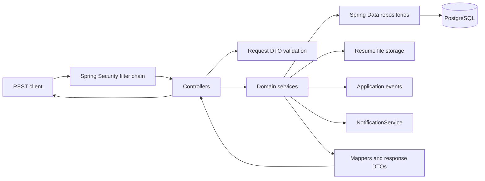
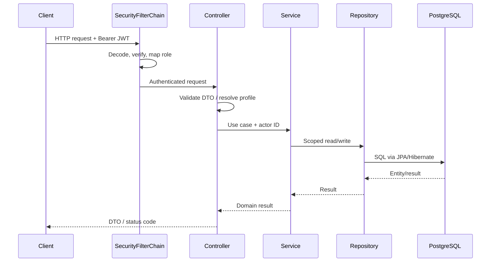
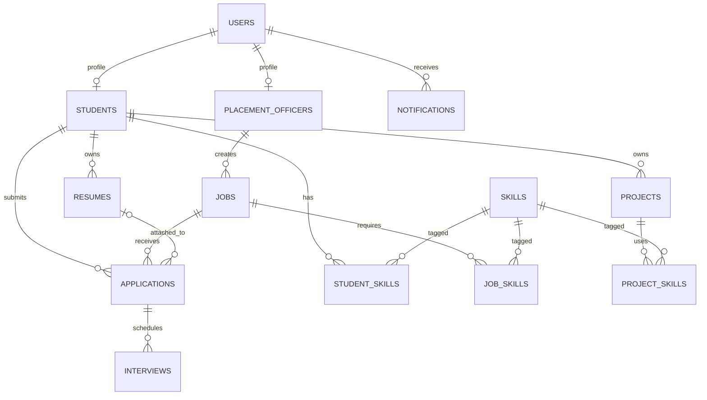
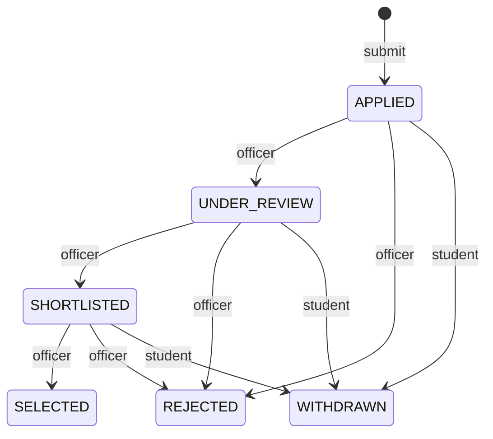
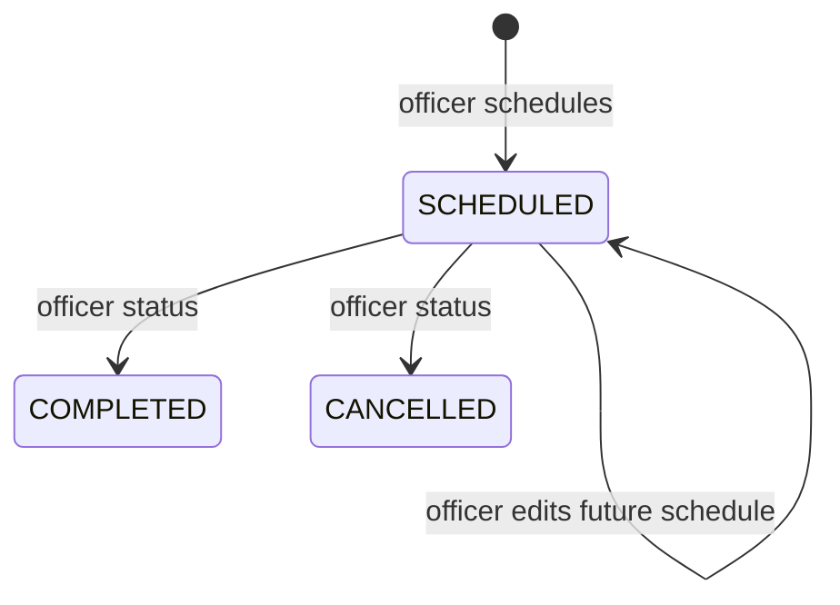

# CampusFlow Backend Master Documentation

> **Repository-grounded reference** for the backend in `backend/campusflow-api`. Schema and behavior statements below are based on the current Java sources, `V1__initial_schema.sql`, `application.properties`, Maven configuration, and reports already present in `target/surefire-reports`. The database version PostgreSQL 18.6 is supplied as the project target; no live database server was queried during this documentation pass.

## Table of Contents

1. [Project Introduction](#1-project-introduction)
2. [System Architecture](#2-system-architecture)
3. [Technology Stack](#3-technology-stack)
4. [Database Design](#4-database-design)
5. [Authentication and Security](#5-authentication-and-security)
6. [Resume Management](#6-resume-management)
7. [Job Management](#7-job-management)
8. [Application Management](#8-application-management)
9. [Interview Management](#9-interview-management)
10. [Notification Management](#10-notification-management)
11. [REST API Documentation](#11-rest-api-documentation)
12. [DTO and Validation Design](#12-dto-and-validation-design)
13. [Exception Handling](#13-exception-handling)
14. [Testing Strategy](#14-testing-strategy)
15. [Configuration and Environment Setup](#15-configuration-and-environment-setup)
16. [Project Directory Structure](#16-project-directory-structure)
17. [Security and Design Decisions](#17-security-and-design-decisions)
18. [Current Implementation Status](#18-current-implementation-status)
19. [Future Improvements](#19-future-improvements)
20. [Technical Glossary](#20-technical-glossary)

---

## 1. Project Introduction

### 1.1 Overview

CampusFlow is a college placement management backend. It provides a REST API for student registration and authentication, job publication and discovery, applications, resumes, interview scheduling, and user notifications. The backend is a Java/Spring layered modular monolith backed by PostgreSQL. There is no separate service deployment per domain in this repository.

### 1.2 Problem statement and objectives

Placement workflows commonly span student records, job opportunities, application review, interview coordination, and timely updates. A fragmented or manual workflow makes ownership, eligibility, status history, and communication harder to manage. CampusFlow centralizes these records and enforces workflow rules at the service and database layers.

Objectives represented by the implementation:

- Authenticate accounts and distinguish students from placement officers.
- Let officers create and manage jobs they own, and let students discover eligible published jobs.
- Record one application per student/job and associate an optional student-owned resume.
- Enforce application and interview status transitions.
- Keep resume files outside the relational database while maintaining metadata and references.
- Create in-app notifications for selected job, application, and interview events.

### 1.3 Existing-system limitations and proposed solution

The project addresses the operational risks of disconnected job/application/interview tracking through a central API, relational constraints, ownership checks, and notifications. The repository does not contain a legacy system study or migration from another placement platform; these are problem-domain motivations, not measured claims about a deployed existing system.

### 1.4 Key features

- Student registration and login with short-lived JWT access tokens.
- Placement-officer authenticated workflows; no public officer registration endpoint is present.
- Officer-owned jobs with draft/publish/close lifecycle and student eligibility filtering.
- Resume PDF upload, metadata, activation state, download path metadata, and deletion protection.
- Application submit, student listing/withdrawal, officer review/status update.
- Interview scheduling for shortlisted applications and status/update/cancel operations.
- Student and officer notification inboxes.
- Flyway-managed schema, DTO mapping, validation, and JUnit/Spring integration tests.

### 1.5 Roles and responsibilities

| Role | Implemented responsibilities |
|---|---|
| `STUDENT` | Register through the public student registration flow; view eligible jobs; manage own resumes; apply to jobs; view/withdraw own applications; view own interviews and notifications. |
| `PLACEMENT_OFFICER` | Authenticate if an account/profile exists; manage own jobs; view applications for owned jobs and update status; schedule/manage interviews for owned applications; view own notifications. The repository has no officer provisioning API. |
| `ADMIN` | The role is accepted by the database role constraint and represented by `Role`; no ADMIN-specific endpoints or role workflow are implemented. |

---

## 2. System Architecture

### 2.1 Overall and layered architecture

The executable is one Spring Boot application (`CampusflowApiApplication`) organized by technical layer and domain DTO packages. Spring components are wired through constructor injection. Services own business rules and transaction boundaries; repositories encapsulate JPA persistence; controllers handle HTTP, authentication context extraction, validation entry points, and response status codes.



### 2.2 Layers and responsibilities

- **Controller** (`controller`): REST mappings and role annotations; obtains the current principal via `JwtAuthenticationToken`, calls services, maps entities to DTOs, and sets `201 Created`/`204 No Content` where applicable.
- **Service** (`service`): use-case logic, ownership checks, eligibility, state transitions, notification triggers, file-storage coordination, and `@Transactional` boundaries.
- **Repository** (`repository`): Spring Data JPA repositories and derived queries. They include scoped lookups such as `findByIdAndStudentId` and `findByIdAndJob_CreatedBy_User_Id`.
- **DTO** (`dto`): API request/response shapes independent of persistence entities. `PageResponseDto` wraps page results.
- **Entity** (`entity`): JPA model and enum types. Flyway SQL is authoritative for the deployed physical schema.
- **Mapper** (`mapper`): explicit static conversion methods, e.g. `ApplicationMapper.toResponseDto` and `JobMapper.toResponseDto`.
- **Security** (`config`, `security`): stateless JWT resource-server configuration, role conversion, principal lookup, password encoder.
- **Exception handling** (`controller/*ExceptionHandler`): scoped REST advice translating domain/validation failures to RFC 7807-style Spring `ProblemDetail` responses.

### 2.3 Request-response lifecycle

1. A request reaches the filter chain. Public routes are the health GET and auth register/login POSTs; all other routes require a valid bearer token.
2. The resource-server JWT decoder verifies the HS256 signature and standard token time claims. `JwtAuthenticationConverter` converts the token role claim to a Spring authority.
3. Method security checks `@PreAuthorize`. Controller code gets the JWT subject (user ID) and resolves the associated student/officer profile.
4. Jakarta Validation runs on `@Valid` request DTOs; service-level checks enforce domain and ownership rules.
5. Service methods interact with repositories and, where applicable, notification/file/event collaborators within transaction boundaries.
6. A mapper creates response DTOs. Advice maps recognized exceptions to `ProblemDetail`; successful responses use the declared DTO/list/page or empty response.



---

## 3. Technology Stack

| Technology | Actual use in this project |
|---|---|
| Java 21 | Maven `java.version`; application and test language/runtime target. |
| Spring Boot 4.1.2 | Parent/BOM and application bootstrap; dependency and auto-configuration management. |
| Spring Web MVC | REST controllers, JSON, multipart resume upload, HTTP response handling. Dependency is `spring-boot-starter-webmvc`. |
| Spring Security | Stateless filter chain, method-level role checks, DAO authentication and BCrypt. |
| OAuth2 Resource Server / JOSE | Nimbus JWT encode/decode and bearer-token authentication; HS256 configured explicitly. This is JWT bearer validation, not an external OAuth login integration. |
| Spring Data JPA | Repository abstraction, pagination, and ORM integration. |
| Hibernate | JPA provider supplied through the Boot JPA starter; maps entities to PostgreSQL. DDL generation is disabled. |
| PostgreSQL (target 18.6) | Relational persistence; JDBC driver is runtime scope. Actual server version was not independently queried. |
| Flyway | Versioned SQL schema migration, with PostgreSQL database module. Current migration is V1 only. |
| Jakarta Validation | Request validation annotations such as `@NotNull`, `@Email`, `@Future`, and `@Positive`. |
| Maven | Build and dependency management; `pom.xml` uses Spring Boot parent. |
| JUnit 5 / Mockito | Test framework and test doubles; Spring Boot test starters and test dependencies are declared. |
| Testcontainers | PostgreSQL/JUnit Jupiter dependencies declared for container-backed integration testing. |
| Actuator | Actuator starter included; no actuator route exposure is configured/documented as an application API here. `/api/v1/health` is an application controller. |

BCrypt hashes passwords via `BCryptPasswordEncoder`. JWTs use an HMAC key from configuration. Resume files are stored on the local filesystem by `ResumeFileStorageService`, not in PostgreSQL or object storage.

---

## 4. Database Design

### 4.1 PostgreSQL and migration strategy

`application.properties` points to `jdbc:postgresql://localhost:5432/campusflow_db`; username and password come from environment variables. `spring.jpa.hibernate.ddl-auto=none` makes Flyway, not Hibernate auto-DDL, responsible for schema creation/evolution. Flyway is enabled and baseline-on-migrate is enabled with baseline version 1. The only migration found is `V1__initial_schema.sql`; subsequent schema changes should be added as new versioned migrations, never by editing an applied migration.

Types below are the SQL types from V1. `TIMESTAMPTZ` maps naturally to timestamp-with-time-zone semantics; Java entity property types should be consulted for application-level representation. All ID columns use `BIGINT GENERATED ALWAYS AS IDENTITY` except the composite join keys.

### 4.2 Tables and columns

| Table | Columns (SQL type; required/default where notable) | Keys, checks, indexes |
|---|---|---|
| `users` | `id BIGINT`; `email VARCHAR(255) NOT NULL`; `password_hash VARCHAR(255) NOT NULL`; `role VARCHAR(30) NOT NULL`; `is_active BOOLEAN NOT NULL DEFAULT TRUE`; `created_at`, `updated_at TIMESTAMPTZ NOT NULL DEFAULT CURRENT_TIMESTAMP` | PK `id`; check normalized lowercase/trimmed email; role in `STUDENT`, `PLACEMENT_OFFICER`, `ADMIN`; unique index `idx_users_email_unique(email)`. |
| `students` | `id BIGINT`; `user_id BIGINT NOT NULL`; `register_number VARCHAR(30) NOT NULL`; `full_name VARCHAR(150) NOT NULL`; `department VARCHAR(100) NOT NULL`; `graduation_year INTEGER NOT NULL`; `cgpa NUMERIC(4,2)`; `phone VARCHAR(15)`; timestamps | PK; FK `user_id → users.id`; unique `user_id`, `register_number`; CGPA 0–10 or null; year 2020–2040. |
| `placement_officers` | `id BIGINT`; `user_id BIGINT NOT NULL`; `employee_id VARCHAR(30) NOT NULL`; `full_name VARCHAR(150) NOT NULL`; `department VARCHAR(100)`; `phone VARCHAR(15)`; timestamps | PK; FK user; unique user and employee IDs. |
| `skills` | `id BIGINT`; `name VARCHAR(100) NOT NULL`; `created_at TIMESTAMPTZ NOT NULL DEFAULT CURRENT_TIMESTAMP` | PK; unique name. |
| `jobs` | `id BIGINT`; `created_by BIGINT NOT NULL`; `company_name VARCHAR(150) NOT NULL`; `job_title VARCHAR(150) NOT NULL`; `job_description TEXT NOT NULL`; `location VARCHAR(150)`; `employment_type VARCHAR(30) NOT NULL`; `work_mode VARCHAR(30) NOT NULL`; `minimum_cgpa NUMERIC(4,2)`; `salary_min`, `salary_max NUMERIC(12,2)`; `application_deadline TIMESTAMPTZ NOT NULL`; `status VARCHAR(20) NOT NULL DEFAULT 'DRAFT'`; timestamps | PK; FK `created_by → placement_officers.id`; checks for status, employment/work enums, CGPA 0–10, nonnegative salaries and max≥min; indexes status, deadline, creator. |
| `student_skills` | `student_id BIGINT NOT NULL`; `skill_id BIGINT NOT NULL`; `proficiency_level VARCHAR(20)`; `created_at TIMESTAMPTZ NOT NULL DEFAULT CURRENT_TIMESTAMP` | Composite PK `(student_id,skill_id)`; FKs to students/skills; proficiency enum check; index `skill_id`. |
| `job_skills` | `job_id BIGINT NOT NULL`; `skill_id BIGINT NOT NULL`; `created_at TIMESTAMPTZ NOT NULL DEFAULT CURRENT_TIMESTAMP` | Composite PK `(job_id,skill_id)`; FKs to jobs/skills; index `skill_id`. |
| `projects` | `id BIGINT`; `student_id BIGINT NOT NULL`; `title VARCHAR(150) NOT NULL`; `description TEXT`; `github_url`, `live_demo_url VARCHAR(500)`; `start_date`, `end_date DATE`; timestamps | PK; FK student; date check end≥start when both set; index student. |
| `project_skills` | `project_id BIGINT NOT NULL`; `skill_id BIGINT NOT NULL` | Composite PK; FKs to projects/skills; index skill. V1 defines no timestamp on this join table. |
| `resumes` | `id BIGINT`; `student_id BIGINT NOT NULL`; `file_name VARCHAR(255) NOT NULL`; `storage_path VARCHAR(500) NOT NULL`; `file_size BIGINT NOT NULL`; `content_type VARCHAR(100) NOT NULL DEFAULT 'application/pdf'`; `is_active BOOLEAN NOT NULL DEFAULT TRUE`; `uploaded_at TIMESTAMPTZ NOT NULL DEFAULT CURRENT_TIMESTAMP` | PK; FK student; size 1..5,242,880 bytes; content type exactly PDF; unique `(id,student_id)` to support composite reference; index student. |
| `applications` | `id BIGINT`; `student_id`, `job_id BIGINT NOT NULL`; `resume_id BIGINT`; `status VARCHAR(30) NOT NULL DEFAULT 'APPLIED'`; `cover_letter TEXT`; `applied_at`, `updated_at TIMESTAMPTZ NOT NULL DEFAULT CURRENT_TIMESTAMP` | PK; FKs student/job; composite FK `(resume_id,student_id) → resumes(id,student_id)` enforces same-owner resume; unique `(student_id,job_id)`; status check; indexes job/status. |
| `interviews` | `id BIGINT`; `application_id BIGINT NOT NULL`; `scheduled_at TIMESTAMPTZ NOT NULL`; `interview_mode VARCHAR(20) NOT NULL`; `location_or_link VARCHAR(500)`; `status VARCHAR(20) NOT NULL DEFAULT 'SCHEDULED'`; `notes TEXT`; timestamps | PK; FK application; mode and status checks; indexes application/scheduled time. |
| `notifications` | `id BIGINT`; `user_id BIGINT NOT NULL`; `title VARCHAR(150) NOT NULL`; `message TEXT NOT NULL`; `notification_type VARCHAR(30) NOT NULL`; `is_read BOOLEAN NOT NULL DEFAULT FALSE`; `created_at TIMESTAMPTZ NOT NULL DEFAULT CURRENT_TIMESTAMP` | PK; FK user; notification type check; indexes user and `(user_id,is_read)`. |

### 4.3 Relationships and ER diagram

`User` has a one-to-one student or placement-officer profile; an officer owns jobs; students own resumes, projects, and student-skill associations; jobs have skill associations and applications; an application belongs to one student and job, and may reference a resume owned by that same student; interviews belong to applications; notifications belong to users. Skills are shared through composite-key association tables.



The SQL FKs do not declare `ON DELETE CASCADE`; deletion behavior must therefore be managed by application workflows or database restriction. `project_skills` has no declared FK cascade either.

---

## 5. Authentication and Security

### 5.1 Registration and login

`POST /api/v1/auth/register` accepts `RegisterStudentRequest`: email, password, register number, name, department, graduation year. `AuthService` normalizes/validates account data, hashes the password via the configured `PasswordEncoder`, creates the user with the student role/profile, and returns an `AuthResponse`. Login accepts email/password, authenticates through `AuthenticationManager`/`DaoAuthenticationProvider` and `UserDetailsServiceImpl`, then issues a token. Only student registration is exposed. Officer account provisioning must be performed outside these endpoints.

Example registration:

```http
POST /api/v1/auth/register
Content-Type: application/json
```
```json
{"email":"student@example.edu","password":"ExamplePass123","registerNumber":"CF2026001","fullName":"A Student","department":"Computer Science","graduationYear":2027}
```

Example response (token value omitted):

```json
{"accessToken":"<signed-access-token>","tokenType":"Bearer","expiresAt":"2026-11-14T10:15:00Z","userId":42,"email":"student@example.edu","role":"STUDENT"}
```

Login body is `{"email":"student@example.edu","password":"ExamplePass123"}` and returns the same response shape. Invalid credentials/duplicate registration are handled by `AuthExceptionHandler`; malformed DTOs receive validation errors.

### 5.2 JWT issuance and validation

`JwtTokenService` issues HS256 access tokens with issuer `campusflow-api`, subject = user ID string, `iat`, `exp` (15 minutes), and custom `email` and `role` claims. `SecurityConfig` reads a Base64-encoded HMAC secret and refuses startup if decoding fails or fewer than 32 bytes are supplied. Nimbus `JwtEncoder` signs, and `JwtDecoder` validates HS256 signatures and timestamps. No refresh token endpoint or revocation store is implemented.

Clients send `Authorization: Bearer <accessToken>`. `JwtAuthenticationConverter` maps the `role` claim into `ROLE_<role>` authority. Controller services use JWT subject to resolve profile IDs; services query data with user/owner scoping.

### 5.3 Spring Security configuration

- CSRF disabled for the stateless API; HTTP Basic and form login disabled.
- `SessionCreationPolicy.STATELESS`.
- `GET /api/v1/health`, `POST /api/v1/auth/register`, and `POST /api/v1/auth/login` are public.
- Every other request must authenticate, then method-level `@PreAuthorize` restricts routes to `STUDENT` or `PLACEMENT_OFFICER`.
- BCrypt is used for stored password hashes; raw passwords are not returned.
- `CustomUserPrincipal` and `UserDetailsServiceImpl` provide account identity and authorities to DAO authentication.

### 5.4 Security test coverage

`SecurityHttpIntegrationTest` has 7 passing tests in the checked-in Surefire report (report timestamp from 2026-11-13), covering the HTTP security behavior; `JwtTokenServiceTest` has 2 passing tests. These are report evidence, not a fresh execution in this task. See [Chapter 14](#14-testing-strategy).

---

## 6. Resume Management

All resume routes require `STUDENT`; records are scoped to the authenticated student. Upload is `multipart/form-data` part `file`. The controller checks nonempty content, declared MIME type `application/pdf`, and configured maximum size; storage service additionally verifies the file signature begins `%PDF-`. Limit is 5 MiB (5,242,880 bytes), also constrained in SQL.

`ResumeFileStorageService` creates the configured directory at startup, writes bytes under a random `UUID.pdf` name using `CREATE_NEW`, normalizes paths, and stores the absolute path in `resumes.storage_path`. The original filename is retained as metadata after stripping path components. Upload persists metadata with `saveAndFlush`; if persistence fails after file creation, the service attempts to remove the new file and suppresses any cleanup error onto the original exception.

Students can list/get their own metadata, activate/deactivate a record, and delete it. Deletion is rejected with conflict if any application references that resume (`existsByResume_Id`). The database row is deleted inside the service transaction; `ResumeDeletedEvent` is published and `ResumeDeletedEventListener` removes the physical file after transaction commit, so rollback does not remove a still-referenced file. The API currently exposes resume metadata, not a binary download endpoint. `is_active` is not enforced as an application prerequisite in `ApplicationService`.

---

## 7. Job Management

Placement officers create jobs in `DRAFT`; the authenticated officer is assigned as owner. Every officer read/update/publish/close/delete is owner-scoped. Student job search returns published jobs and filters by optional `location`, `employmentType`, and `workMode`, plus the student's CGPA against `minimumCgpa`. If minimum CGPA is set and the student's CGPA is null/below threshold, the job is excluded/not retrievable through student details.

Job creation/update DTO requires company, title, description, employment type, work mode, and a future deadline. Optional location, minimum CGPA (0–10), and salary bounds are validated; DB also enforces nonnegative salary and max≥min. Publishing/closing lifecycle rules are in `JobService`; publishing triggers eligible-student job notifications. The controller validates sorting to `companyName`, `jobTitle`, `location`, `applicationDeadline`, `createdAt`, or `updatedAt`. Default page size is 20; defaults sort created time descending. Search parameters do not include keyword or skills. There is no separate “close by deadline” scheduler visible in source.

---

## 8. Application Management

Students submit a job ID, optional resume ID, and optional cover letter. The service requires a student profile, existing published job, deadline in the future, no prior student/job application, and satisfaction of minimum CGPA. Resume association is optional; when present it must belong to that student. A database unique constraint handles concurrent duplicate submissions. New records start `APPLIED`; submission creates a notification for the job-owning officer.

Students can page through and retrieve their own applications and withdraw eligible applications. Officers can page/retrieve applications only for their jobs and change status along the officer transition map. Status changes notify the student. Withdrawal is blocked for `SELECTED`, `REJECTED`, or already `WITHDRAWN`; other statuses, including `SHORTLISTED` and `UNDER_REVIEW`, may be withdrawn.



`SELECTED`, `REJECTED`, and `WITHDRAWN` are terminal in the service transition logic. Application updates use `PATCH /status`; there is no application delete endpoint.

---

## 9. Interview Management

Officers schedule interviews only for applications they own whose status is `SHORTLISTED`. The scheduled time must be in the future, mode is required (`ONLINE`/`OFFLINE`), and a nonblank location/link up to 500 characters is required. Optional notes are accepted. Scheduling notifies the student.

Students can list/get interviews that belong to their applications; officers can only list/get/update/delete interviews belonging to applications attached to their jobs. Only `SCHEDULED` interviews can be updated or status-changed; valid status changes are `COMPLETED` or `CANCELLED`. Cancellation triggers a student notification. Changed scheduling details trigger an update notification. Delete is officer-only and has no notification trigger. There is no explicit “student cancel” route.



Both `COMPLETED` and `CANCELLED` are terminal through the current API/service transitions.

---

## 10. Notification Management

Separate route prefixes enforce role audience, but each controller derives the recipient from the authenticated JWT subject; the service scopes individual reads, updates, and deletes by `(notificationId,userId)`. In-app notifications are persisted as rows with type (`JOB_UPDATE`, `APPLICATION_UPDATE`, `INTERVIEW`, `SYSTEM`), unread by default.

Triggers implemented: published job → active eligible students; submitted application → job owner; application status change → student; interview scheduled/changed/cancelled → student. Read-one, read-all, list, detail, and delete operations are implemented. Lists default to 20, newest first. A duplicate guard checks same user/title/message/type before insert. This is content-based suppression, not a unique database constraint or idempotency key; concurrent duplicate creation can still race, and repeated identical events can be suppressed even if they represent distinct occurrences. Job publication loops through matching students and may be unbounded at larger scale.

---

## 11. REST API Documentation

### Conventions

- Unless marked public, include `Authorization: Bearer <token>`.
- JSON request bodies use `Content-Type: application/json`. Multipart upload uses `multipart/form-data` with `file` part.
- Page endpoints accept Spring `page` (zero-based), `size`, and `sort=property,asc|desc`; see endpoint-specific sort constraints below. Default page size is 20.
- Success payload fields are represented by DTOs; examples show the actual API shape in representative form. Error responses are Spring `ProblemDetail` where an advice handler applies; security-filter errors may be standard Spring Security responses.
- Common errors: `400` validation/illegal input, `401` missing/invalid authentication, `403` wrong role or eligibility/ownership denial, `404` scoped resource absent, `409` conflict/invalid workflow, `413` upload too large.

### 11.1 Authentication

| Method and URL | Purpose / access | Parameters and body | Success / errors / notable validation |
|---|---|---|---|
| `POST /api/v1/auth/register` | Register student; public | No path/query. Body: `email`, `password`, `registerNumber`, `fullName`, `department`, `graduationYear`. | `201 AuthResponse` (`accessToken`, `tokenType`, `expiresAt`, `userId`, `email`, `role`). `400` validation; duplicate/conflict per `AuthExceptionHandler`. Email format/max 255; password 8–72; name 150; department 100; register number 30; year 2020–2040. |
| `POST /api/v1/auth/login` | Authenticate; public | Body: `email`, `password`. | `200 AuthResponse`; `400` malformed input; `401` authentication failure. Email valid/max255; password nonblank. |

Example login request: `{"email":"student@example.edu","password":"ExamplePass123"}`. Response shape is shown in Chapter 5.

### 11.2 Resume

Base `/api/v1/student/resumes`; role `STUDENT` on all routes.

| Method and URL | Purpose | Body/parameters | Success and key errors |
|---|---|---|---|
| `POST /api/v1/student/resumes` | Upload PDF | Multipart part `file` | `201 ResumeResponseDto`, `Location: /api/v1/student/resumes/{id}`; `400` missing/invalid PDF; `413` >5 MiB. |
| `GET /api/v1/student/resumes` | List own resumes | None | `200` JSON array of resume DTOs. |
| `GET /api/v1/student/resumes/{id}` | Get own resume metadata | Path `id` | `200 ResumeResponseDto`; `404` absent or not owned. |
| `PATCH /api/v1/student/resumes/{id}/activate` | Activate own resume | Path `id` | `200 ResumeResponseDto`; `404` absent/not owned. |
| `PATCH /api/v1/student/resumes/{id}/deactivate` | Deactivate own resume | Path `id` | `200 ResumeResponseDto`; `404` absent/not owned. |
| `DELETE /api/v1/student/resumes/{id}` | Delete own resume/file | Path `id` | `204`; `404` absent/not owned; `409` resume referenced by application. |

Resume response fields are `id`, `studentId`, `fileName`, `fileSize`, `contentType`, `isActive`, and `uploadedAt` (storage path is not exposed in response mapping).

### 11.3 Jobs

Officer routes require `PLACEMENT_OFFICER`; student routes require `STUDENT`.

| Method and URL | Access / purpose | Parameters/body | Success / key errors / validation |
|---|---|---|---|
| `POST /api/v1/officer/jobs` | Officer creates owned draft | `JobRequestDto` | `201 JobResponseDto`, Location header; `400` invalid DTO; ownership derives from token. |
| `GET /api/v1/officer/jobs` | List own jobs | Page/sort; allowed sort: companyName, jobTitle, location, applicationDeadline, createdAt, updatedAt | `200 PageResponseDto<JobResponseDto>`; `400` unsupported sort. |
| `GET /api/v1/officer/jobs/{id}` | Get own job | Path `id` | `200 JobResponseDto`; `404` absent/not owned. |
| `PUT /api/v1/officer/jobs/{id}` | Replace editable job fields | Path `id`; full `JobRequestDto` | `200 JobResponseDto`; `400` validation; `404`; workflow conflicts per service. |
| `PATCH /api/v1/officer/jobs/{id}/publish` | Publish own job | Path `id`; no body | `200 JobResponseDto`; `404`/`409` invalid state. |
| `PATCH /api/v1/officer/jobs/{id}/close` | Close own job | Path `id`; no body | `200 JobResponseDto`; `404`/`409` invalid state. |
| `DELETE /api/v1/officer/jobs/{id}` | Delete own job | Path `id` | `204`; `404`/conflict when relational restrictions prevent delete. |
| `GET /api/v1/student/jobs` | Search eligible published jobs | Optional `location`, `employmentType`, `workMode`; page/sort allowed fields above | `200 PageResponseDto<JobResponseDto>`; `400` invalid enum/sort. |
| `GET /api/v1/student/jobs/{id}` | Get published eligible job detail | Path `id` | `200 JobResponseDto`; `404` not published/not eligible/not found. |

Job request JSON:

```json
{"companyName":"Example Ltd","jobTitle":"Backend Engineer","jobDescription":"Build Java services.","location":"Chennai","employmentType":"FULL_TIME","workMode":"HYBRID","minimumCgpa":7.0,"salaryMin":600000,"salaryMax":900000,"applicationDeadline":"2027-01-15T18:00:00Z"}
```

Validation: company/title nonblank max150; description nonblank; location max150; employment/work mode required enums; minimum CGPA 0–10; salaries nonnegative and DB requires max≥min; deadline future.

### 11.4 Applications

| Method and URL | Access / purpose | Parameters/body | Success / key errors / validation |
|---|---|---|---|
| `POST /api/v1/student/applications` | Submit application | Body `{jobId, resumeId?, coverLetter?}` | `201 ApplicationResponseDto` and Location; `400` invalid IDs; `403` CGPA/profile; `404` job/resume; `409` closed/expired/duplicate. |
| `GET /api/v1/student/applications` | List own applications | Page/sort default `appliedAt,desc` | `200 PageResponseDto<ApplicationResponseDto>`. |
| `GET /api/v1/student/applications/{id}` | Get own application | Path `id` | `200 ApplicationResponseDto`; `404` absent/not owned. |
| `PATCH /api/v1/student/applications/{id}/withdraw` | Withdraw own application | Path `id`; no body | `200 ApplicationResponseDto`; `409` terminal/invalid status. |
| `GET /api/v1/officer/applications` | List applications for own jobs | Page/sort default `appliedAt,desc` | `200 PageResponseDto<ApplicationResponseDto>`. |
| `GET /api/v1/officer/applications/{id}` | Get application for own job | Path `id` | `200 ApplicationResponseDto`; `404` absent/not owned. |
| `PATCH /api/v1/officer/applications/{id}/status` | Change status for owned application | Body `{"status":"UNDER_REVIEW"}` | `200 ApplicationResponseDto`; `400` invalid enum/null; `404` absent/not owned; `409` illegal transition. |

Application response fields: `id`, `studentId`, `jobId`, nullable `resumeId`, `companyName`, `jobTitle`, `coverLetter`, `status`, `appliedAt`, `updatedAt`. Submission requires positive `jobId`; optional resume ID must be positive.

### 11.5 Interviews

| Method and URL | Access / purpose | Parameters/body | Success / key errors / validation |
|---|---|---|---|
| `GET /api/v1/student/interviews` | Student's interviews | Page/sort default scheduledAt ascending | `200 PageResponseDto<InterviewResponseDto>`. |
| `GET /api/v1/student/interviews/{id}` | Student gets own interview | Path `id` | `200 InterviewResponseDto`; `404` absent/not owned. |
| `POST /api/v1/officer/interviews` | Schedule for owned shortlisted application | Body `{applicationId,scheduledAt,interviewMode,locationOrLink,notes?}` | `201 InterviewResponseDto` + Location; `400` invalid/future/location; `404` absent/not owned; `409` application not shortlisted. |
| `GET /api/v1/officer/interviews` | List interviews for owned jobs | Page/sort default scheduledAt ascending | `200 PageResponseDto<InterviewResponseDto>`. |
| `GET /api/v1/officer/interviews/{id}` | Get own interview | Path `id` | `200 InterviewResponseDto`; `404` absent/not owned. |
| `PUT /api/v1/officer/interviews/{id}` | Replace schedule details | Path `id`; full `{scheduledAt,interviewMode,locationOrLink,notes?}` | `200 InterviewResponseDto`; `400`, `404`, `409` if not scheduled. |
| `PATCH /api/v1/officer/interviews/{id}/status` | Complete/cancel | Body `{"status":"COMPLETED"}` or `CANCELLED` | `200 InterviewResponseDto`; only scheduled can transition; invalid transition is conflict. |
| `DELETE /api/v1/officer/interviews/{id}` | Delete own interview | Path `id` | `204`; `404` absent/not owned. |

Example schedule body: `{"applicationId":81,"scheduledAt":"2027-01-05T09:30:00Z","interviewMode":"ONLINE","locationOrLink":"https://meet.example/room","notes":"Technical round"}`. Response contains `id`, `applicationId`, `scheduledAt`, `interviewMode`, `locationOrLink`, `status`, `notes`, `createdAt`, and `updatedAt`.

### 11.6 Student notifications

Base `/api/v1/student/notifications`; `STUDENT` role. Officer notification endpoints have equivalent behavior under `/api/v1/officer/notifications` and `PLACEMENT_OFFICER` role.

| Method and URL | Purpose | Parameters/body | Success / errors |
|---|---|---|---|
| `GET /api/v1/student/notifications` | List own notifications | `page`, `size`, `sort`; default size20, createdAt desc | `200 PageResponseDto<NotificationResponseDto>`. |
| `GET /api/v1/student/notifications/{id}` | Get own notification | Path `id` | `200`; `404` not found/not owned. |
| `PATCH /api/v1/student/notifications/{id}/read` | Mark one read | Path `id` | `200 NotificationResponseDto`; `404`. |
| `PATCH /api/v1/student/notifications/read-all` | Mark all own notifications read | No body | `204`; invalid user ID context `400`/denied. |
| `DELETE /api/v1/student/notifications/{id}` | Delete own notification | Path `id` | `204`; `404`. |

### 11.7 Officer notifications

Same five HTTP operations and response shapes as student notifications, with base path `/api/v1/officer/notifications` and required role `PLACEMENT_OFFICER`. The `read-all` route is `/api/v1/officer/notifications/read-all`.

### 11.8 Health

| Method and URL | Access | Purpose / response |
|---|---|---|
| `GET /api/v1/health` | Public | Executes `SELECT 1` through `JdbcTemplate`, then returns `{"status":"UP","application":"CampusFlow","database":"CONNECTED"}`. A database connection failure prevents a successful response. No separate liveness/readiness routes are implemented in this controller. |

---

## 12. DTO and Validation Design

DTOs prevent controllers from binding persistence entities directly and define request validation and response contracts. DTO packages are grouped by auth, job, application, interview, resume, notification, student, officer, skill, project, and association domains. Mappers are explicit classes in `mapper`; mapping is hand-written rather than generated.

Validation annotations present include `@NotBlank`, `@NotNull`, `@Email`, `@Size`, `@Min`, `@Max`, `@DecimalMin`, `@DecimalMax`, `@Positive`, and `@Future`. Validation only runs for parameters annotated `@Valid`; database constraints provide additional safeguards, including salary range and same-student resume ownership.

`PageResponseDto<T>` flattens Spring Data `Page<T>` into `content`, `page`, `size`, `totalElements`, `totalPages`, `first`, `last`, `hasNext`, `hasPrevious`. Example:

```json
{"content":[],"page":0,"size":20,"totalElements":0,"totalPages":0,"first":true,"last":true,"hasNext":false,"hasPrevious":false}
```

---

## 13. Exception Handling

Domain exception classes include `ApplicationNotFoundException`, `ApplicationConflictException`, `InvalidApplicationTransitionException`, `InterviewNotFoundException`, `InvalidInterviewOperationException`, `JobNotFoundException`, `NotificationNotFoundException`, `ResumeNotFoundException`, and `ResumeInUseException`. Authentication has a separate auth advice. Advice classes are scoped by controller, except `ResumeExceptionHandler` which is a general `@RestControllerAdvice`.

| Failure | Typical mapping in advice |
|---|---|
| Missing resource | `404 Not Found` (`ProblemDetail`) |
| Invalid request/validation/enum or `IllegalArgumentException` | `400 Bad Request` |
| Invalid application/interview transition, resume in use | `409 Conflict` |
| Upload over configured maximum | `413 Content Too Large` |
| Role or ownership denial | `403 Forbidden` (security filter may handle unauthenticated requests as `401`) |
| Authentication failure | Auth handler/security authentication entry point, typically `401` |

Problem bodies use Spring `ProblemDetail` fields such as `type`, `title`, `status`, and `detail`; handlers often return a concise detail rather than field-by-field validation errors. Framework/security errors outside controller advice may differ in body format. Job, application, and interview advice also maps their service exceptions and status exceptions; see each `*ExceptionHandler` for exact behavior.

---

## 14. Testing Strategy

### 14.1 Test classes and coverage areas

Test sources currently present:

| Test class | Focus inferred from class/tests |
|---|---|
| `CampusflowApiApplicationTests` | Spring context and database-backed application integration; report contains 6 tests. |
| `SecurityHttpIntegrationTest` | HTTP security and role/JWT access behavior; 7 tests. |
| `ResumeControllerHttpTest` | Resume upload/controller HTTP behavior; 7 tests. |
| `ResumeServiceTest` | Resume service rules; 3 tests. |
| `ResumeDeletedEventListenerTest` | After-commit file cleanup listener; 2 tests. |
| `ApplicationServiceTest` | Application submission/status/withdrawal rules; 4 tests. |
| `InterviewServiceTest` | Interview scheduling/lifecycle/ownership behavior; 4 tests. |
| `NotificationServiceTest` | Notification creation, ownership/read behavior; 3 tests. |
| `AuthServiceTest` | Registration/login service behavior; 5 tests. |
| `JwtTokenServiceTest` | JWT claims/signing/token metadata; 2 tests. |
| `PageResponseDtoTest` | Page wrapper serialization/flags; 5 tests. |

Test dependencies include Spring Boot test starters, Testcontainers PostgreSQL and JUnit Jupiter. The integration test source should be consulted for its exact container/migration setup; V1 is the only migration. `SecurityTestEndpoints` provides test-only endpoints for security testing. HTTP tests cover the actual MVC/security path, while service tests isolate business rules using test doubles where configured.

### 14.2 Latest available results (not a new run)

Existing Surefire `.txt` reports in `target/surefire-reports` are dated by the surrounding build output on **2026-11-13**. Report totals:

| Test class | Run | Failures | Errors | Skipped |
|---|---:|---:|---:|---:|
| CampusflowApiApplicationTests | 6 | 0 | 0 | 0 |
| ResumeControllerHttpTest | 7 | 0 | 0 | 0 |
| PageResponseDtoTest | 5 | 0 | 0 | 0 |
| ResumeDeletedEventListenerTest | 2 | 0 | 0 | 0 |
| SecurityHttpIntegrationTest | 7 | 0 | 0 | 0 |
| ApplicationServiceTest | 4 | 0 | 0 | 0 |
| AuthServiceTest | 5 | 0 | 0 | 0 |
| InterviewServiceTest | 4 | 0 | 0 | 0 |
| JwtTokenServiceTest | 2 | 0 | 0 | 0 |
| NotificationServiceTest | 3 | 0 | 0 | 0 |
| ResumeServiceTest | 3 | 0 | 0 | 0 |
| **Total** | **48** | **0** | **0** | **0** |

This is evidence of the recorded run only. It does not establish that the current working tree (if modified after that report) passes. The present documentation task did not execute tests.

---

## 15. Configuration and Environment Setup

### 15.1 Required configuration

`src/main/resources/application.properties` contains:

- `spring.application.name=campusflow-api`
- PostgreSQL URL default `jdbc:postgresql://localhost:5432/campusflow_db`
- `DB_USERNAME` and `DB_PASSWORD` environment substitutions
- `APP_JWT_SECRET` as required Base64 HMAC key, minimum 32 decoded bytes
- Resume storage path from `RESUME_STORAGE_LOCATION`, default `./uploads/resumes`
- Upload maximum 5,242,880 bytes
- Hibernate DDL disabled, SQL logging enabled, open-in-view disabled
- Flyway enabled with baseline-on-migrate and baseline version 1

Never place production credentials in source control or logs. Supply secrets through the deployment environment/secret manager. No actual secret values are included here.

### 15.2 Requirements and commands

- Java 21 JDK. The repository includes the Maven Wrapper scripts and wrapper configuration; the wrapper downloads Maven 3.10.0 as configured in `.mvn/wrapper/maven-wrapper.properties`.
- PostgreSQL available at the configured host/port with database `campusflow_db` and supplied credentials.
- Docker is required only for the Testcontainers-backed tests; local PostgreSQL may be used for manual development.
- Provide a valid Base64 JWT key before app startup.

From `backend/campusflow-api`:

```powershell
$env:DB_USERNAME = "<database-user>"
$env:DB_PASSWORD = "<database-password>"
$env:APP_JWT_SECRET = "<base64-encoded-key-of-at-least-32-bytes>"
$env:RESUME_STORAGE_LOCATION = "./uploads/resumes"
.\mvnw.cmd spring-boot:run
```

Build/package: `.\mvnw.cmd clean package`. Run tests: `.\mvnw.cmd test`. Run one test: `.\mvnw.cmd -Dtest=ApplicationServiceTest test`. These are documented commands; this documentation pass did not execute them.

---

## 16. Project Directory Structure

```text
backend/campusflow-api/
├── .mvn/
│   └── wrapper/
│       └── maven-wrapper.properties
├── mvnw
├── mvnw.cmd
├── pom.xml
└── src/
    ├── main/
    │   ├── java/com/campusflow/
    │   │   ├── CampusflowApiApplication.java
    │   │   ├── config/          # SecurityConfig, ResumeStorageProperties
    │   │   ├── controller/      # HTTP endpoints and scoped exception advice
    │   │   ├── dto/             # Request/response contracts by domain
    │   │   ├── entity/          # JPA entities and enums
    │   │   ├── event/           # ResumeDeletedEvent and after-commit listener
    │   │   ├── exception/       # Domain exception types
    │   │   ├── mapper/          # Entity-to-DTO mapping
    │   │   ├── repository/      # Spring Data interfaces
    │   │   ├── security/        # Principal, user details, JWT converter
    │   │   └── service/         # Use cases and file storage
    │   └── resources/
    │       ├── application.properties
    │       └── db/migration/V1__initial_schema.sql
    └── test/java/com/campusflow/
        ├── controller/
        ├── dto/common/
        ├── event/
        ├── security/
        ├── service/
        └── CampusflowApiApplicationTests.java
```

Notable orchestration classes: `AuthService`, `JwtTokenService`, `ApplicationService`, `InterviewService`, `JobService`, `NotificationService`, `ResumeService`, `ResumeFileStorageService`, `AuthenticatedStudentService`, and `AuthenticatedPlacementOfficerService`. Student profile, projects, skills, and association entities/services/repositories exist in source/schema, but the inspected controller set has no corresponding CRUD REST controllers.

---

## 17. Security and Design Decisions

- **Layered monolith:** keeps domain workflows in one deployable process and gives clear controller/service/repository boundaries without distributed transaction complexity.
- **JWT bearer authentication:** allows stateless API requests and is supported by Spring's resource-server pipeline. Access tokens expire after 15 minutes; refresh, logout/revocation, and key rotation workflows are not present.
- **DTO boundary:** avoids exposing entity internals and provides request validation and stable page/response contracts.
- **Service ownership checks:** a role alone does not grant access to another officer's job or another student's records. Scoped repository queries protect the object-level boundary.
- **Transactions:** related database operations and notification writes occur in service workflows. Resume metadata deletion is transactional to coordinate its physical file cleanup.
- **After-commit file deletion:** avoids removing a file if the DB transaction rolls back. A filesystem failure after commit can still leave an orphaned file; there is no retry/outbox record visible.
- **Testcontainers:** exercises SQL/Flyway behavior with PostgreSQL rather than substituting an in-memory database with different SQL semantics.
- **Trade-offs:** local filesystem storage requires shared/persistent storage in multi-instance deployments; HS256 secret distribution is a shared-key responsibility; notification duplicate detection is best effort; synchronous job publication notification fanout may scale poorly.

---

## 18. Current Implementation Status

Status terms: **Implemented** = code path exists; **Tested and verified** = corresponding existing report records a successful test; **Partially implemented** = some domain model/service exists but requested product surface is incomplete; **Planned** is not inferred from names or schema. No explicit roadmap/planned markers were found, so planned work is listed as not specified.

| Feature | Status | Relevant classes | Test evidence / limitations |
|---|---|---|---|
| Student registration/login/JWT | Tested and verified | `AuthController`, `AuthService`, `JwtTokenService`, `SecurityConfig` | Auth and JWT report suites pass; no officer onboarding endpoint. |
| Roles and endpoint security | Tested and verified | `SecurityConfig`, `JwtAuthenticationConverter`, controllers | 7 HTTP integration tests; ADMIN has no API workflow. |
| Resume upload/metadata/lifecycle | Tested and verified | `ResumeController`, `ResumeService`, `ResumeFileStorageService`, event classes | Controller 7, service 3, listener 2 tests; no resume binary download API. |
| Officer job management/student search | Implemented | `JobController`, `JobService`, `JobRepository` | No dedicated `JobServiceTest` file found in test sources. |
| Application workflow | Tested and verified | `ApplicationController`, `ApplicationService`, entity/status | 4 service tests; no automatic deadline closure. |
| Interview workflow | Tested and verified | `InterviewController`, `InterviewService` | 4 service tests. |
| Notifications | Tested and verified | Notification controllers/service/repository | 3 service tests; no push/email delivery; duplicate suppression not concurrency-safe. |
| Skills and projects persistence/domain | Partially implemented | Entities, services, repositories, DTOs/mappers, V1 schema | No matching REST controllers or test classes identified; persistence models exist without public CRUD API. |
| Student profile and officer profile API | Partially implemented | Profile entities/services/DTOs/mappers | No profile controllers; officer provisioning absent. |
| ADMIN APIs | Not implemented | `Role.ADMIN`, SQL role check | No ADMIN controller or endpoint policy. |
| External email/SMS notification | Not implemented | None found | Notifications are in-app database records only. |
| Refresh/revoke JWT session | Not implemented | No refresh/revocation controller/service | Access token only, 15-minute TTL. |
| Binary resume retrieval | Not implemented | Resume metadata endpoints only | No download/content endpoint in `ResumeController`. |
| Production object storage | Not implemented | Local `ResumeFileStorageService` | Local filesystem path; deployment persistence/shared-volume concerns. |
| Test suite latest available reports | Tested and verified | 11 test classes in Chapter 14 | Existing report total 48/0/0/0 from 2026-11-13; no fresh test run here. |

No explicit planned feature marker was found in inspected source. Future improvements below are recommendations, not committed roadmap items.

---

## 19. Future Improvements

### Essential before broader production use

1. Add officer account provisioning and a governed ADMIN workflow; document identity lifecycle and account activation.
2. Add resume download/streaming with authorization, content-disposition safety, and malware scanning; move storage behind a pluggable abstraction suitable for persistent object storage.
3. Add retryable after-commit cleanup (outbox/job or reconciliation) for orphaned files and cleanup observability.
4. Add concurrency-safe notification/event idempotency where duplicate prevention matters; avoid a read-before-insert race.
5. Review JWT key rotation, revocation/refresh policy, rate limiting on auth, and production secret provisioning.
6. Add explicit pagination size limits and allowed-sort validation consistently across pageable routes; validate pagination bounds.
7. Add dedicated Job, controller/error-contract, migration, and broader PostgreSQL integration tests; establish CI execution and retain current test evidence.
8. Add database indexes based on measured query plans and expected access patterns, including notification and application listing filters where needed.

### Optional enhancements

- REST endpoints for student profiles, projects, skills, and skill associations already represented in domain/schema.
- Search by keywords/skills and richer job filters.
- Email/push notifications, delivery preferences, and templates.
- Audit trail for officer status changes and interview edits.
- API versioning policy, OpenAPI generation, and contract compatibility checks.
- Metrics, structured logs, tracing, health/readiness integration, and operational dashboards.
- Scheduled deadline handling and retention/archival policies.

---

## 20. Technical Glossary

| Term | Meaning in this backend |
|---|---|
| API | HTTP interface used by clients to invoke CampusFlow operations. |
| BCrypt | Adaptive one-way password hashing algorithm used through Spring's `PasswordEncoder`. |
| Controller | Spring MVC class that maps HTTP requests to application service calls. |
| DTO | Data Transfer Object; explicit request/response contract separate from JPA entity. |
| Entity | JPA-mapped Java object representing a persisted relational row. |
| Flyway | Versioned migration tool that applies SQL schema changes in order. |
| Hibernate | JPA implementation handling entity persistence and SQL generation. |
| HTTP 401/403 | 401 means authentication is missing/invalid; 403 means authenticated but disallowed. |
| HTTP 409 | Conflict, used for conflicting state or invalid workflow transitions. |
| JPA | Jakarta Persistence standard for object-relational mapping. |
| JWT | Signed JSON Web Token carrying subject, time, and role/email claims. |
| Monolith | One deployable application containing multiple modules/domains. |
| ORM | Object-relational mapping between Java domain objects and relational tables. |
| PostgreSQL | Relational database storing users, placement, and notification data. |
| Repository | Persistence abstraction that loads/saves entities and executes queries. |
| REST | Resource-oriented HTTP API style using methods such as GET, POST, PATCH, PUT, DELETE. |
| Stateless authentication | Each request carries credentials/token; server does not rely on an HTTP session. |
| Testcontainers | Test library that provisions disposable containers, including PostgreSQL, for tests. |
| Transaction | Atomic database unit; `@Transactional` groups operations and controls commit/rollback. |
| UUID | Random unique identifier used for physical resume filenames. |

---

## Source Reference Index

All paths are relative to repository root:

- Bootstrap/build/config: `backend/campusflow-api/pom.xml`; `src/main/java/com/campusflow/CampusflowApiApplication.java`; `src/main/resources/application.properties`.
- Schema: `backend/campusflow-api/src/main/resources/db/migration/V1__initial_schema.sql`.
- HTTP mappings: `src/main/java/com/campusflow/controller/` (including `AuthController`, `ResumeController`, `JobController`, `ApplicationController`, `InterviewController`, student/officer notification controllers, and `HealthController`).
- Security: `src/main/java/com/campusflow/config/SecurityConfig.java`; `src/main/java/com/campusflow/security/`; `src/main/java/com/campusflow/service/JwtTokenService.java`.
- Domain logic: `src/main/java/com/campusflow/service/`.
- Persistence model/queries: `src/main/java/com/campusflow/entity/`; `src/main/java/com/campusflow/repository/`.
- DTOs and mappers: `src/main/java/com/campusflow/dto/`; `src/main/java/com/campusflow/mapper/`.
- Exceptions/events: `src/main/java/com/campusflow/exception/`; `src/main/java/com/campusflow/event/`.
- Tests and existing execution reports: `src/test/java/com/campusflow/`; `target/surefire-reports/`.
